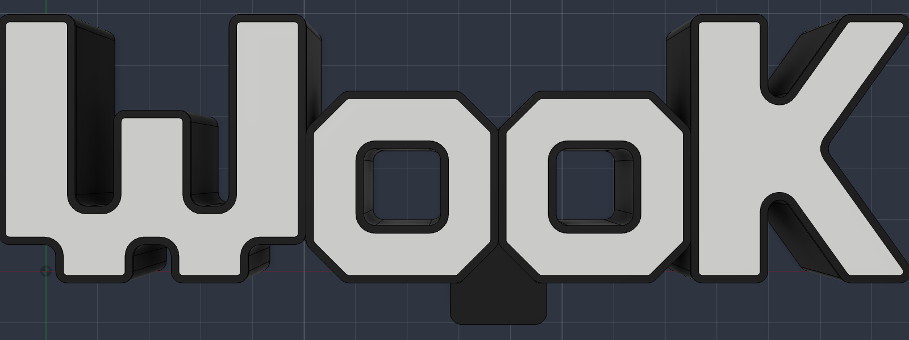
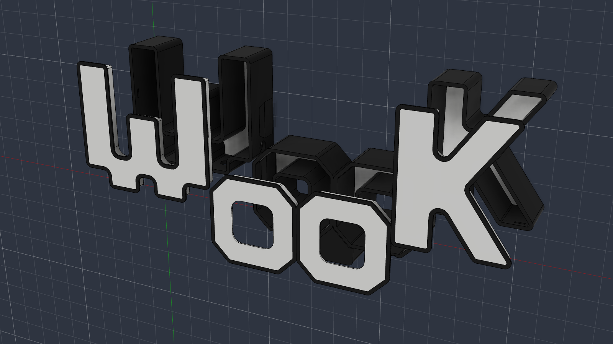
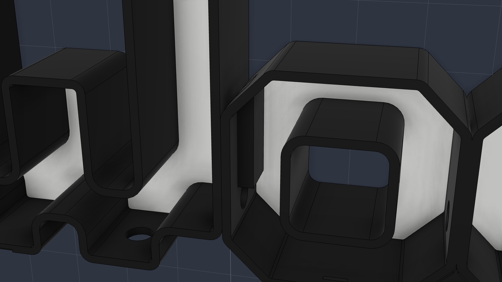
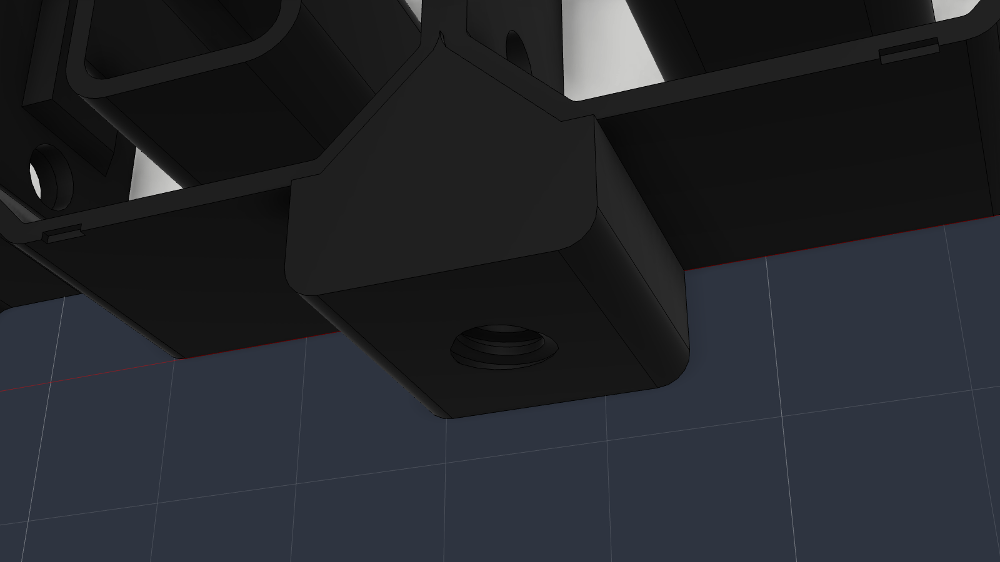

# Wook Lightbox

A 19" light-up "Wook" sign that mounts on a pole as a totem. It's a remake of an older, smaller version, designed in Autodesk Fusion in November 2026 and printed on a Bambu Lab H2D with AMS.



The sign is 482.5 × 164.4 × 52.9 mm (19.0" × 6.5" × 2.1") including the pole collar. It's hollow so LEDs can go inside, with black walls and translucent faces on both sides. The back reads "Wook" mirrored, so it looks right from behind.

## What's in this repo

| Path | What it is |
|---|---|
| `print/Wook_Lightbox_19in.3mf` | **Open this in Bambu Studio.** 6 objects, colors assigned, in mm. |
| `cad/Wook_Lightbox.f3d` | The Fusion design (File > Open > Open from my computer). |
| `cad/Wook_Lightbox.step` | Same model as STEP, for any other CAD program. |
| `wook_build/wook_build.py` | The script that builds the whole model in Fusion from scratch. This is the real source; the f3d is its output. |
| `tools/regroup_3mf.py` | Turns Fusion's raw 3MF export into the 6-object file Bambu needs. |
| `docs/` | Renders of this version, plus `docs/reference/` photos of the old sign it's based on. |

## The parts



The sign is too wide for any print bed, so it's split into three body pieces that slide together, plus one removable front cap per piece:

| Object in Bambu | What it is | Footprint |
|---|---|---|
| **W Body** | black W walls + translucent back face, printed as one multi-material piece | 171 × 142 mm |
| **W Cap** | black lip + translucent front face + black skirt | 163 × 142 mm |
| **OO Body** | both o's in one piece: walls, back faces, black window tubes, pole collar | 203 × 124 mm |
| **OO Cap** | both o front caps | 2 × 102 × 102 mm |
| **K Body** | black K walls + translucent back face | 124 × 142 mm |
| **K Cap** | black lip + translucent front face | 116 × 142 mm |

Everything fits on the H2D bed (350 × 320 mm). It would also fit any 256 mm Bambu bed, but not an A1 mini (180 mm).

### How it goes together

- **Dovetails.** The W and the K each have a vertical dovetail tail that drops straight down into a socket in the oo. Gravity holds them in, and they can't pull apart sideways. The oo carries the weight because the pole screws into it. Fit clearance is 0.4 mm per side (0.2 mm was too tight to assemble on the first print). Because the dovetail flanks are only about 15° off parallel, that clearance allows about 1.5 mm of side-to-side play before the joint locks.
- **Front caps snap in.** Each cap is a translucent face with a short black skirt underneath that slides into the letter. The skirt is black because it's hidden behind the wall anyway, and it keeps the translucent filament limited to the faces (see Printing). A 1.5 mm black lip sits on top of the wall's rim. The lip is exactly the shape of the wall, so from the front it reads as the black border. It also stops the cap from being pushed in too far. Small 0.5 mm bumps on the skirt click into grooves inside the wall. Fit clearance is 0.1 mm per side.
- **Removing a cap.** Each letter has a small 8 × 1.5 mm pry slot on its bottom edge, right under the lip. Use a fingernail or a flat screwdriver.
- **The back isn't removable.** The back faces are printed fused to the body (multi-material), so only the front opens. That's deliberate: one opening is enough to get at the LEDs.
- **o windows.** The square holes in the o's are framed by black tubes that run the full depth of the oo. The front o caps have a matching opening that fits around them.



### Wiring

- There are 14 mm holes through the walls between each pair of letters (W|o, o|o, o|K), 32.4 mm up from the bottom. They're cut through both mating parts at once, so they line up across the dovetail joints. 14 mm is sized for chunky LED connector clips.
- There are 14 mm power-in holes on the bottom of the W (right foot) and the K (stem), so the cable can come out at either end.
- There are no LED mounting features. Stick the strip to the inside walls.

### Pole mount



- A collar hangs below the gap between the two o's. It's 51 mm wide, 22 mm tall, and the full depth of the sign.
- It holds a 3/4"-5 ACME female thread, 20 mm deep. That's the standard US broom handle thread, and the male end on a broomstick (or a printed pole) screws straight in.
- The thread is a modeled Fusion Thread feature, so it's real geometry and prints as is.
- The thread did NOT scale when the sign was scaled up, on purpose.
- The thread is opened up by `pole_thread_clear` (0.4 mm per side) for printing. Printed at exact spec, a broom handle wouldn't even start.

**Changing the pole thread.** In Fusion, Modify > Change Parameters:

| Parameter | Default | What it does |
|---|---|---|
| `pole_hole_d` | 19.05 mm | Hole diameter. Set it to the nominal size of the new thread. |
| `pole_thread_len` | 20 mm | How deep the thread goes. |
| `collar_h` | `pole_thread_len + 2 mm` | Collar height. Follows the thread automatically. |
| `collar_w` | 51.0 mm | Collar width. Could come down to about 30 mm for a 3/4" thread. |
| `pole_thread_clear` | 0.4 mm | Print clearance on the thread, per side. Moves the flanks, root and crest outward. 0 = exact spec. |

Then double-click **Pole thread** in the timeline to choose a different standard (ISO metric, trapezoidal, other ACME sizes, pipe...). I tested an M20×2.5 swap and it rebuilt cleanly. The collar is only as deep as the sign (52.9 mm), so a thread wider than about 45 mm won't fit.

## Printing

Settings I used: 0.3 mm layers. The black lips and translucent faces are both 1.5 mm, exactly 5 layers, so the color change lands on a layer boundary.

1. Open `print/Wook_Lightbox_19in.3mf`. If Bambu asks, map the two colors to your filaments: `#191919` black and `#F6F6F3` translucent white.
   - **Slow faces for clarity.** The translucent filament is used *only* for the 1.5 mm faces (front and back). So instead of modifiers, set a low **Max volumetric speed** on the translucent filament preset and save it as a custom preset. Every face prints slowly and everything else stays at full speed. Flow = layer height × line width × speed, so at 0.3 mm layers and 0.42 mm lines: 10 mm/s = 1.26 mm³/s, 20 mm/s = 2.52 mm³/s, 30 mm/s = 3.78 mm³/s. The stock Bambu PETG Translucent profile is 6 mm³/s (about 48 mm/s). On the body prints, the first 5 layers mix both colors, so minimum layer time can stretch those whole layers a little.
2. It loads assembled, so press **A** (Arrange) or spread it across plates.
3. **Body pieces:** leave them back face down, as imported. The translucent back face prints first and the black walls build on top.
4. **Caps:** flip them face down (lip on the bed).
5. **Supports:** only needed under the dovetails. Each dovetail has an 8 × 43 mm surface about 15° from horizontal: under each tail on the W and K, and the matching surface in each oo socket. Paint supports there. On the H2D, PLA supports on a PETG part (or the reverse) peel right off. Nothing else needs support. The socket blocks have 45° chamfers so they print on their own.
6. **Test first.** Print one o cap and the oo before committing to everything, to check the snap fit and clearance.

## Lessons from test prints

- **Cap clearance.** 0.2 mm per side was too loose on an early K test print, so it's now 0.1 mm. If 0.1 is too tight, change `CLEAR` in `wook_build.py` to 0.015 (cm, so 0.15 mm).
- **Snap bumps.** `BUMP_H` = 0.5 mm is an unprinted guess. Tune it after the first cap.
- **Dovetail clearance.** 0.2 mm per side was too tight to slide together (the support-side surfaces are rougher than the rest). It's now 0.4 mm (`DT_CLEAR`, in mm).
- **Pole thread clearance.** The first print used the exact 3/4"-5 ACME spec, and the broom handle wouldn't catch even half a turn. Heating the hole with a heat gun let it thread in most of the way. It's now opened up 0.4 mm per side (`pole_thread_clear`). That gives a crest of 15.76 mm and a root of 20.64 mm, versus 14.96 / 19.84 at spec.

## How the model is built

Everything is generated by `wook_build/wook_build.py`. I never edited the Fusion timeline by hand: every change was a script edit plus a full rebuild. That's why the f3d timeline has about 250 features with auto-generated names.

The script was written and run by Claude Code (Anthropic's CLI coding agent) through Fusion's MCP server. You can also run it yourself without Claude; see below.

**Letters** are drawn on a 5 mm pixel grid, then scaled 2.0346×:

- **W:** a bitmap of 16 × 14 cells, two thick U's with a notch at the bottom.
- **o:** an octagon of 10 × 10 cells, with a square window from cell 3 to cell 7.
- **K:** a polygon of 12 × 14 cells with straight diagonal legs. The notches beside the stem are deep, so the legs are an even thickness.

Every vertical edge gets a 6.1 mm round. The build steps:

1. Extrude each letter's outline and shell it, so you get thin walls open at both ends.
2. Join the two o's into one piece. Add the dovetail tails to the W and K, and the socket blocks to the oo.
3. Cut the wire and power holes, and add the pole collar with its thread.
4. Cut the snap grooves and pry slots into the front wall rim.
5. Build the front caps: lip (the wall's footprint), face (inside the wall), and skirt with snap bumps.
6. Add the back faces and the o window tubes.

**Scaling.** The original design was 237.2 mm wide, and everything visual scales by `S = 482.6 / 237.2`. These are deliberately not scaled: the thread, the 14 mm holes, all fit clearances, the snap bumps, the pry slots, and the 1.5 mm lip and face thickness. To make a different size, change `TARGET_W_MM` at the top of the script.

### Rebuilding from the script

> `phase_body()` deletes the active design's entire timeline. Run it in the Wook design or a new empty design, never in anything else. It refuses to run if the design has components other than Body / Front / Back.

**From Fusion directly:**

1. Utilities > Add-Ins > Scripts and Add-Ins.
2. Click **+** next to My Scripts and pick the `wook_build/` folder.
3. Run it. `run()` does the whole build plus the checks. The check output shows up in the Text Commands window.

**With Claude Code and the Fusion MCP server:**

- Enable the MCP server in Fusion's preferences, then register it with Claude Code:
  `claude mcp add -s user --transport http autodesk-fusion http://127.0.0.1:27182/mcp`
- Use `127.0.0.1`, not `localhost`. Fusion's server rejects `localhost` with 403 "Invalid Host header", which shows up in Claude Code as a connection failure.
- Run the phases as separate calls. One giant script timed out the MCP call, even though Fusion finished it:

```python
g = {'__name__': 'wook_build'}
exec(open('/path/to/wook_build/wook_build.py').read(), g)
g['phase_body']()          # call 1
g['phase_caps'](True)      # call 2 (these three can share a call)
g['phase_back']()
g['phase_finish']()
g['phase_check']()         # call 3, can be readOnly
```

`phase_check()` prints:

- overall size
- interference between all parts (should be 0)
- per cap: seated overlap 0, snap engages when pulled out 1 mm, lip stops it 0.5 mm in, fit tighter than 0.15 mm
- dovetail: drops in freely, locks sideways
- the 14 mm hole positions
- every overhang flatter than 40°

### Re-exporting for Bambu

Fusion's 3MF export has two problems:

- It puts all 17 bodies as separate top-level objects, so Bambu shows 17 things to group by hand.
- It writes the units as **feet**.

`tools/regroup_3mf.py` fixes both. It regroups the bodies into the 6 objects as 3MF components, which Bambu treats like its own Assemble, and converts to mm.

1. In Fusion: File > Export > 3MF, whole design, to `print/Wook_Lightbox_19in_fusion.3mf`.
2. Run `python3 -I tools/regroup_3mf.py print/Wook_Lightbox_19in_fusion.3mf print/Wook_Lightbox_19in.3mf`.
3. Optional check: `/Applications/BambuStudio.app/Contents/MacOS/BambuStudio --info print/Wook_Lightbox_19in.3mf` should list 6 objects, all `manifold = yes`.

If you add or rename bodies, update `GROUPS` at the top of the script. It refuses to run if any body is unassigned.

## Design history

Roughly in order:

1. **Starting point.** Started from photos of the old sign (`docs/reference/`): a pixel-font "Wook" lightbox with a pole socket.
2. **Letter shapes.** The first version was pixel-stepped. The W and K were redrawn chunkier and rounded to match the photos. The K went through a lowercase version to a capital K with straight diagonal legs and deep stem notches. The o's got 45° corners to match.
3. **Two-sided.** Added a mirrored translucent back. The o window walls lost their support when the back opened up, so they first became cap tubes, then black tubes fused to the body.
4. **Dovetails and pole mount.** Split the sign into W / oo / K with vertical drop-in dovetails. Added the threaded pole mount. It first cut into the o's, which looked bad, so it moved to a collar below the gap between the o's.
5. **Depth.** 35 mm was too deep. Half that (17.5 mm) couldn't hold the broom thread with flush walls, so it went to 26 mm at 9" wide.
6. **Size.** Scaled to 19" wide, everything except the functional sizes. The collar was cut down to the minimum (thread + 2 mm).
7. **Cap retention.** Added the black lip, snap bumps and pry slots.
8. **Fixed back.** Made the back fixed (fused to the body), tightened the cap fit to 0.1 mm after a test print, and enlarged the holes to 14 mm.
9. **Socket blocks.** Shrunk them so they don't run the full depth and shadow the LEDs.
10. **Black skirts.** Made the cap skirts black so the only translucent material is the faces. A slow speed limit on that filament then only slows the visible layers.

## Open items / ideas

- Tune `BUMP_H` and `CLEAR` after the first real print.
- `collar_w` could shrink to about 30 mm.
- A male-threaded printed pole end was discussed but never built.
- The dovetails could be redesigned with 45° flanks so they need no supports.
